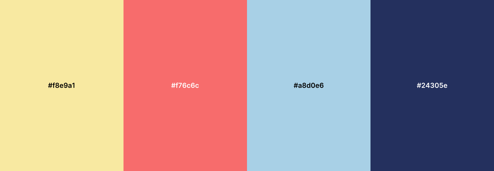

This repository contains the source code and assets for my website portfolio, my very first website!

Check it out here! [la1qa.github.io](https://la1qa.github.io/)

The website is a space to showcase my projects, experience, skills and interests. I want it to feel personal, balancing a professional presentation with simplicity and character. The visual direction uses warm neutral backgrounds, clean typography, generous whitespace and subtle colour accents, letting the content speak for itself.

Built with React, TypeScript, HTML and CSS, the project is also an opportunity to experiment with web development, explore new ideas and continuously improve my skills.

<!--
#ffffff
#f8e9a1
#f76c6c
#a8d0e6
#24305e  
#222222
-->

<!--  -->

<!--
https://pixelied.com/colors/palette-editor/f8e9a1-f76c6c-a8d0e6-24305e-ffffff-222222
-->

### Development
The project is version-controlled with Git and hosted on GitHub Pages. It is continuously evolving as I learn, experiment and add new projects and features.